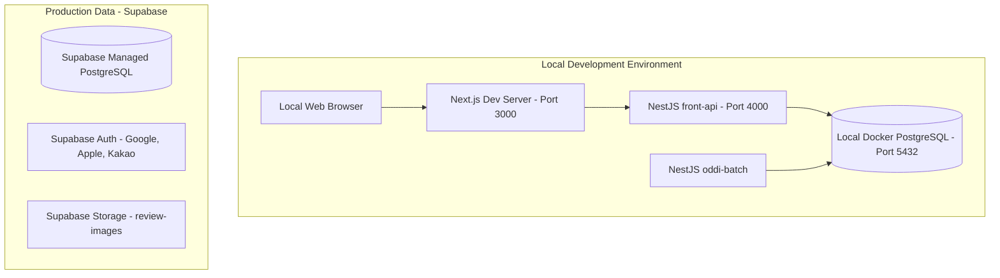

# 🏗️ ODDI Infrastructure Architecture Overview

> **위치:** `apps/oddi-infra/docs/01-Infrastructure-Overview.md`  
> **최종 수정일:** 2026-11-13  
> **관련 문서:** [[02-Local-Development-Setup]]

---

## 1. 개요 (Overview)

**오디 (ODDI)** 인프라는 **로컬 개발 환경 (Local Docker PostgreSQL)** 과 **상용 데이터 계층 (Supabase Cloud)** 으로 나뉜다.

애플리케이션 런타임은 Kubernetes로 올리지 않고, Argo CD로 동기화하지 않는다. 이 저장소의 운영 절차는 로컬 데이터베이스와 Supabase 연동까지다.

---

## 2. 구성 (Layout)

로컬 서비스는 개발자 머신에서 직접 실행한다. 상용 환경의 PostgreSQL, 인증, 스토리지는 Supabase 프로젝트가 담당한다.

---

## 3. 구성요소별 역할

| 구성요소 | 로컬 | 상용 |
| :--- | :--- | :--- |
| **`front-web`** | `npm run dev` (`localhost:3000`) | 이 저장소의 배포 대상이 아님 |
| **`front-api`** | `npm run start:dev` (`localhost:4000`) | 이 저장소의 배포 대상이 아님 |
| **`oddi-batch`** | 수동 로컬 실행 | 이 저장소의 배포 대상이 아님 |
| **`database`** | Docker Container (`oddi-postgres`:5432) | Supabase Cloud Managed PostgreSQL |
| **`auth / storage`** | Supabase Dev Project | Supabase Prod Project (Google, Apple, Kakao) |
